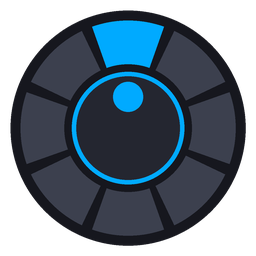

# Rueda Suprema

Menú radial (estilo Surface Dial) para la **rueda de volumen del teclado AJAZZ AK820**.
Se queda en segundo plano junto al reloj, sin gastar CPU, y al pulsar la rueda abre un menú que se controla girándola.

**HECHO POR @BYALVARO__**

## Cómo se usa

| Acción | Menú cerrado | Menú abierto |
|---|---|---|
| Girar la rueda | Sube o baja el volumen (con el OSD propio) | Cambia de opción / ajusta el valor |
| Clic | Abre el menú | Entra en la opción o confirma |
| Mantener pulsado | Silencia o quita el silencio | Cierra el menú |

También funciona con el ratón: pasa por encima para elegir, clic para entrar, clic derecho para cerrar y la rueda del ratón para girar. Con `Esc` se cierra.

## Opciones del menú

- **Volumen general**: un arco animado con el porcentaje.
- **Mezclador de apps**: volumen de cada app con su propio icono. Si una app tiene varias sesiones de audio (por ejemplo, dos instancias), salen por separado.
- **Salida de audio**: cambia entre cascos y altavoces; cada salida con el icono que elijas en Ajustes.
- **Micrófono**: volumen del micro. También hay **Silenciar micro**.
- **Silenciar sonido**.
- **Play / Pausa**, **Siguiente**, **Anterior**: muestra la canción que suena.
- **Avanzar / retroceder**: salta 5 segundos por muesca en la canción (en Spotify, YouTube en el navegador y apps compatibles).
- **Ajustes**.

## Ajustes

Clic derecho en el icono de la bandeja → **Ajustes…**

- Volumen por muesca (1–10 %)
- Muescas necesarias para pasar de opción en el menú (sensibilidad del menú)
- Invertir el sentido de giro
- Qué hace el botón: clic, doble clic o mantener para abrir el menú
- Qué silencia el botón: el sonido o el micrófono directamente
- Icono de cada salida de audio (altavoces, cascos, monitor, Bluetooth…)
- Tiempo que cuenta como «mantener»
- Qué opciones salen en el menú y en qué orden
- Tamaño, opacidad, color de acento y cierre automático del menú
- OSD de volumen propio, sonidos al girar e inicio con Windows

La configuración se guarda en `%APPDATA%\RuedaSuprema\config.ini`.

## Consumo

Programa nativo en C++/Win32, sin .NET ni Electron. Cuando no tocas la rueda está bloqueado esperando mensajes (0 % de CPU) y libera la memoria de dibujo al cerrar el menú.

## Compilar

- **Automático**: cada `push` a `main` compila con GitHub Actions y publica `RuedaSuprema.exe` en **Releases**.
- **En tu PC**: instala *Build Tools for Visual Studio* con «Desarrollo para el escritorio con C++» y ejecuta `build.bat`.

Requiere Windows 10 (1809) o Windows 11.

## Si la rueda no responde

- Si el clic no abre el menú, prueba en Ajustes «Al pulsar, la rueda envía: Play / Pausa».
- Si tu teclado no detecta «mantener pulsado», usa el modo **Doble clic: abrir menú**.
- En el icono de la bandeja puedes **Pausar** el programa y la rueda vuelve a funcionar como siempre.
